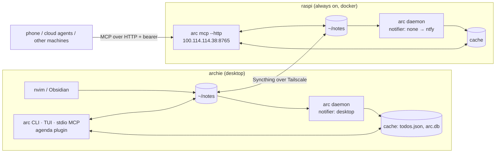

# arc notes sync: design & architecture

**Goal:** one set of Markdown notes and todos that every editor, agent and machine reads and writes, with no machine acting as a single point of failure for day-to-day work.

**Status (2026-10-09):** deployed on archie (desktop) and raspi (Pi hub), synced with Syncthing, and verified end to end. The details are in [Verification](#verification). The [Open items](#open-items) section lists what's still waiting on you.

## The core decision: files are the source of truth

Notes stay plain Markdown files on disk, and every machine holds a full copy. Everything else is a **derived, per-machine cache** that can be rebuilt from the files at any time:

| Data | Where | Synced? | Rebuildable? |
|---|---|---|---|
| Notes, story notes, todos (`- [ ]` checkboxes) | `~/notes/**.md` | yes (Syncthing) | it *is* the source |
| Todo cache | `<cache>/todos.v2.json` | no | yes (daemon scan) |
| Query index | `<cache>/arc.db` (SQLite) | no | yes |
| Fired reminders | `<cache>/fired-reminders` | no | yes. Losing it costs at most one repeat overdue summary |
| Config, secrets | `~/.config/arc/config.toml` | no | — |

This is why editing a note in nvim needs neither sshfs nor a network round trip: your editor writes a local file, Syncthing ships it, and each machine's arc daemon re-derives its cache from it.

Before this work, manual todos lived **only** in `todos.json` with random UUIDs. That one fact made syncing between machines impossible, which is why it was the first change.



## Todos

### Where todos live
- **Global todos:** `todos.md` at the notes root (frontmatter `type: todos`). `arc todo add --global`, the TUI's add dialog, and legacy todos all go here.
- **Repo todos:** `todos/<host>/<owner>/<repo>.md`, e.g. `todos/github.com/tenzinplatter/arc.md`. Frontmatter `repo: github.com/tenzinplatter/arc` is what scopes them.
  - Any note with a `repo:` key scopes its checkboxes. A project or story note can opt in the same way.
- **Story todos:** checkboxes in story notes, as before.
- **Session scope:** an inline `#session/<id>` token on the checkbox line. It's stripped before the id is computed.
- **Due dates:** `@dd-mm-yyyy` inline, as before. The CLI and MCP take `YYYY-MM-DD` and convert it.

### Deterministic ids
`id = UUIDv5(namespace, "<file>\0<lowercased text>\0<occurrence>")`. A test pins the value.

- **Same id on every machine.** The id depends only on content that syncs, so `arc todo done <id>` copied from the agenda on archie works against the Pi's MCP.
- **Stable when** you tick it, re-date it, move it within the file, change whitespace or case, or add or remove a session token.
- **Changes when** you edit the text or move it to another file. At that point it's arguably a different todo.
- **Done and remove locate the checkbox by id** in the current file contents, never by a cached line number. If you've edited the note since the cache was built, they still hit the right line, or refuse without writing.

### Repo keys
`RepoKey::canonical` is the only constructor: it lowercases, strips scheme, credentials, port, `.git`, query and fragment, and collapses `/`. A remote with no host (local path, `file://`) gives **no key**, and the todo is global.

Only the `origin` remote counts. A directory-name fallback was removed because it differs between machines and collides.

### Legacy migration
On the first run of any arc command or the TUI, manual todos in a legacy-format `todos.json` are appended to `todos.md` exactly once (yours: 19 todos):
- It runs under the legacy cache's lock.
- Afterwards the file is renamed to `todos.json.adopted`, which marks it done for good.
- The live cache is `todos.v2.json`, so an old binary still running during an upgrade can never cause a second adoption.

## Daemon (each machine)
`arc daemon run`:
- Watches the notes dir with inotify. That catches both your edits and Syncthing's.
- Rescans everything at startup, so todos.json and arc.db are rebuilt from scratch and stale entries from notes deleted while it was down are dropped.
- Fires reminders at 09:00 local time on a todo's due date, plus one overdue summary.

Reliability fixes made here:
- **Single instance:** a `daemon.lock` in the cache dir. A second daemon on the same cache refuses to start.
- **Fired log:** keyed by `(todo id, date)`, so a todo you re-date after it fired will fire again. An entry is written **only after delivery succeeds**. Failures retry at 1, 2, 4… minutes, capped at 30. The log is pruned of entries older than 30 days and rewritten atomically.

### Notifier: one machine notifies
```toml
[notifier]
kind = "ntfy"            # "desktop" (default, DBus) | "ntfy" | "none"
url = "http://100.114.114.38:2586"
topic = "arc"
token = "tk_..."         # ntfy access token
```
- **Today:** archie uses `desktop` (the default), and the Pi uses `none`.
- **Intended:** the Pi uses `ntfy` (it's always on, and pushes reach your phone), and archie switches to `none`. That's blocked on an ntfy token, see [Open items](#open-items).

Only one machine should notify. Every daemon sees every synced todo, so two notifying daemons would mean duplicate reminders.

## Remote MCP (Pi)
`arc mcp --http 100.114.114.38:8765` serves the same tools as the stdio server at `/mcp` (stateless streamable HTTP, JSON responses).

**Security model:**
- Only reachable on the tailnet: docker publishes port 8765 on the Tailscale IP only. The container binds `0.0.0.0` internally with `--allow-host 100.114.114.38`.
- Plus a required bearer token. The binding type makes "non-loopback without a token" impossible to construct.
- A Host-header guard against DNS rebinding.
- A 1 MiB body limit and 16 concurrent requests.
- Note reads and writes are canonicalised and must stay inside the notes dir, so a symlink synced in by a peer can't escape it.

**Local vs remote** is a type (`Locality`), not a convention:

| Tool | Local (stdio) | Remote (HTTP) |
|---|---|---|
| `current_story` | `cwd` → git branch | `branch` only. `cwd` is rejected |
| `log_session` | `cwd`, `branch`, or `story_id` | `branch` and/or `story_id`. A phone can pass just `story_id` |
| `add_todo` | `cwd` → origin → repo file; `repo`; `global` | `repo` (key or any remote URL) or `global: true`. `cwd` is rejected |

Branch names coming from the network are validated against git's ref-format rules. That stops a crafted branch from injecting Markdown into session headers.

**Index freshness:** the remote server reads the Pi's index. The Pi daemon keeps that index current from synced files, which is why both run on the Pi.

### Registering it
```sh
claude mcp add --transport http arc-remote http://100.114.114.38:8765/mcp \
  --header "Authorization: Bearer $(ssh raspi cat ~/hearth/arc/mcp-token)"
```
On machines with a local arc and checkout, keep the stdio `arc` server. It's faster, works offline, and can see your `cwd`.

## Deployment

### archie
- **arc:** `~/.cargo/bin/arc` (installed with `cargo install --path ~/code/arc`). The daemon runs as the systemd user unit `arc.service` (`arc daemon install`).
- **Syncthing:** `~/.local/bin/syncthing` v2.1.6 (static binary, signature checked). It runs as the systemd user unit `syncthing.service` and keeps its state in `~/.local/state/syncthing/`.

### raspi (`~/hearth/compose.pi.yaml`)
- **`syncthing`:**
  - `/home/tenzin/notes` is mounted at `/notes`.
  - Sync port 22000/tcp+udp is published on the Tailscale IP only.
  - The GUI on 8384 is **loopback only** (it has no password). Use `ssh -L 8384:127.0.0.1:8384 raspi`, then http://localhost:8384.
- **`arc`** (`arc daemon run`) and **`arc-mcp`** (`arc mcp --http …`):
  - Both use the image `arc:local`, built natively on the Pi from the repo's `Dockerfile` (cold build about 6 min, rebuild about 100 s).
  - They share the config at `~/hearth/arc/config` and the Pi-local cache at `~/hearth/arc/cache`.
  - Both run with `init: true` so SIGTERM is handled.

**To update the Pi after an arc change:**
```sh
cd ~/code/arc && git archive HEAD | ssh raspi 'rm -rf ~/build/arc && mkdir -p ~/build/arc && tar -xf - -C ~/build/arc'
ssh raspi 'cd ~/build/arc && docker build -t arc:local . && cd ~/hearth && docker compose -f compose.pi.yaml up -d arc arc-mcp'
```

### Syncthing settings
- Folder `notes`, send-receive on both machines.
- Direct `tcp://<tailscale-ip>:22000` addresses. Global discovery and relays are off.
- Usage reporting declined, auto-upgrade off.
- `.stignore`: editor swap files, `.DS_Store`, `.obsidian/workspace*`.
- Change latency is about 12–15 s, most of it Syncthing's 10 s watcher batching. You can lower `fsWatcherDelayS` if that bothers you.

## Conflicts & failure modes
- **Concurrent edits to the same file on two machines before a sync:** Syncthing keeps both and writes `*.sync-conflict-*.md`. arc **never indexes** conflict copies or anything under a dot-directory (`.stversions`, `.stfolder`, `.obsidian`, `.git`), so todos and reminders aren't duplicated. A conflict therefore shows up only in Syncthing's GUI or in `ls`; merge it by hand and delete the copy. Per-repo todo files keep unrelated edits in separate files, so these conflicts are rare.
- **A machine is offline:** it keeps working on its local copy and catches up when it reconnects. Nothing depends on the Pi being up except the remote MCP and (eventually) phone reminders.
- **Cache corruption or loss:** delete `<cache>/todos.v2.json` and `arc.db*`, then restart the daemon. It rebuilds everything from the notes.
- **The daemon isn't running:** the CLI, the agenda and the MCP server read the cache, so edits made directly in files (yours, or synced ones) don't appear until a daemon is running. Writes made through arc update the cache themselves.
- **Older arc binaries:** an older arc that writes config back drops the `[notifier]` and `mcp_token` keys. Run the same build everywhere.

## Verification
All checks ran on the real machines on 2026-10-09, and the probe data was cleaned up afterwards.

| Check | Result |
|---|---|
| Syncthing create / edit / delete, each direction | ~11.5 s per hop, sha256 matches |
| An `arc todo add` on archie appears in the Pi's notes | 14 s |
| An archie edit appears in the Pi daemon's cache | 13 s |
| Remote MCP `add_todo` (repo scope) appears in archie's note and agenda list | 12 s |
| Remote MCP without a token, or with a wrong one | 401 |
| `docker compose restart arc arc-mcp` | both come back clean |
| Migration of the real legacy `todos.json` | 19 todos moved into `todos.md`, no duplicates |
| Workspace tests / clippy | all pass, no warnings |

Each feature branch was reviewed by an independent subagent, and the review findings were fixed before integration. A final review then looked at cross-feature interactions, and its findings were fixed before the merge.

## Open items
These need you:

1. **ntfy token, for phone reminders.** The Pi's ntfy rejects anonymous publishing (403), and a subagent's permission check blocked it from going looking for credentials. Create a token for an `arc` user that can write to topic `arc` (`docker exec -it ntfy ntfy token add <user>`). Then:
   - Pi `~/hearth/arc/config/arc/config.toml`: `[notifier] kind = "ntfy"`, `url = "http://100.114.114.38:2586"`, `topic = "arc"`, `token = "tk_…"`, and `docker compose -f compose.pi.yaml restart arc`.
   - archie `~/.config/arc/config.toml`: `[notifier] kind = "none"`, and `systemctl --user restart arc`.
   - Subscribe to `arc` in the ntfy phone app. Reminder titles go in ntfy's `title` query parameter, so the em dash should come through correctly, but check the first one.
2. **Register the remote MCP** wherever you want it (it's already reachable):
   `claude mcp add --transport http arc-remote http://100.114.114.38:8765/mcp --header "Authorization: Bearer $(ssh raspi cat ~/hearth/arc/mcp-token)"`
3. **Restart open Claude Code sessions** and any running `arc` TUI. The agenda plugin was updated to 0.6.0, and the TUI now watches `todos.v2.json`.
4. **Tidy-up (optional):**
   - `~/.cache/arc/todos.json{,.lock}` on archie and in the Pi's cache are unused now.
   - Pre-migration backups: `~/backups/arc-sync-20261008-2348/` (archie) and the same path on raspi.
   - Merged feature worktrees are still under `~/code/arc/.worktrees/`.
5. **Known limitations, accepted for now:**
   - Editing a due todo's text gives it a new id, so its reminder fires again.
   - A reminder retry keeps going until delivered, even if the todo is completed in the meantime. This only matters while ntfy fails.
   - A todo more than 30 days overdue is no longer reminded about.
   - An older arc binary that writes config back drops the `[notifier]` and `mcp_token` keys.
   - The remote MCP container holds your Shortcut token, mounted read-only, for story lookups.

## Considered and rejected
- **One central arc on the Pi that every agent calls:** you still need local files for nvim, so sync is needed anyway. Centralising only adds a network hop and breaks `cwd` and git-based tools.
- **`## <repo>` sections inside one todos.md:** Syncthing syncs whole files, so unrelated repos would conflict. A heading rename could also silently re-scope todos.
- **Database-backed apps (Trilium, Outline):** agents edit files better than they drive APIs, and files fit the editor workflow.
- **Syncing `arc.db`:** copying SQLite through a file syncer corrupts it. It's a derived cache, so each machine builds its own.
